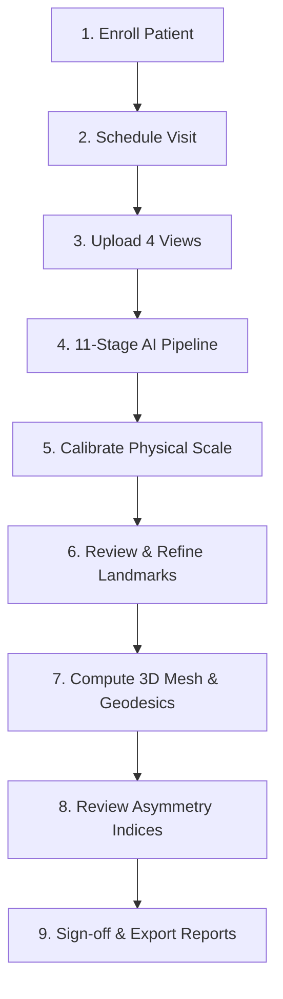
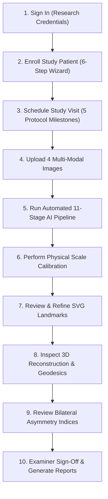

# AI Facial Asymmetry Analysis Platform — User Manual & Operating Instructions

> **Regulatory & Clinical Research Disclaimer**: This software platform is strictly engineered for clinical research measurement, bilateral asymmetry documentation, and longitudinal study data management. Quantitative measurements, AI landmark predictions, 3D surface reconstructions, and biostatistical outputs do **not** constitute medical diagnoses, clinical treatment plans, or autonomous surgical recommendations. All outputs require validation and sign-off by a qualified clinical examiner.

---

## Table of Contents
1. [Platform Overview & Study Scope](#1-platform-overview--study-scope)
2. [User Roles & Access Permissions (RBAC)](#2-user-roles--access-permissions-rbac)
3. [Longitudinal Protocol & Study Milestones](#3-longitudinal-protocol--study-milestones)
4. [Step-by-Step Clinical Research Workflow](#4-step-by-step-clinical-research-workflow)
   - [Step 4.1: Enrolling a Patient](#step-41-enrolling-a-patient)
   - [Step 4.2: Scheduling & Initializing Study Visits](#step-42-scheduling--initializing-study-visits)
   - [Step 4.3: Standardized Multi-Modal Image Acquisition & Upload](#step-43-standardized-multi-modal-image-acquisition--upload)
   - [Step 4.4: 11-Stage AI Pipeline Execution & Real-Time Monitoring](#step-44-11-stage-ai-pipeline-execution--real-time-monitoring)
   - [Step 4.5: Physical Scale Calibration (Ruler Fiducials & OPG Scaling)](#step-45-physical-scale-calibration-ruler-fiducials--opg-scaling)
   - [Step 4.6: Interactive Landmark Review & Audit Refinement (SVG/Canvas)](#step-46-interactive-landmark-review--audit-refinement-svgcanvas)
   - [Step 4.7: Interactive 3D Mesh Reconstruction & Dijkstra Geodesic Surface Paths](#step-47-interactive-3d-mesh-reconstruction--dijkstra-geodesic-surface-paths)
   - [Step 4.8: Quantitative Asymmetry Indices & Longitudinal Biostatistics](#step-48-quantitative-asymmetry-indices--longitudinal-biostatistics)
   - [Step 4.9: 13-Section Research Reports & Multi-Format Export](#step-49-13-section-research-reports--multi-format-export)
5. [System Administration & Database-Backed Settings](#5-system-administration--database-backed-settings)
   - [Dynamic API Key Configuration (Gemini, NVIDIA, OpenAI)](#dynamic-api-key-configuration-gemini-nvidia-openai)
   - [User Management & Role Assignment](#user-management--role-assignment)
   - [Immutable Audit Trail & Regulatory Compliance](#immutable-audit-trail--regulatory-compliance)
6. [Single-Shot Execution & Troubleshooting FAQ](#6-single-shot-execution--troubleshooting-faq)

---

## 1. Platform Overview & Study Scope

The **AI Facial Asymmetry Analysis Platform** is an enterprise-grade clinical research system designed to standardize, accelerate, and validate quantitative facial asymmetry assessments in patients who have sustained **unilateral mandibular fractures treated by open or closed reduction and internal fixation (ORIF)**.

### Core Objectives
1. **Longitudinal Precision**: Track facial and mandibular bilateral symmetry across **five fixed chronological visits** from pre-injury/pre-operation through 6 months post-fixation.
2. **Multi-Modal Verification**: Correlate soft-tissue surface photos (Frontal, Right Lateral, Left Lateral) with underlying bony structures using Orthopantomograms (OPG).
3. **Dual-Coordinate Audit Trail**: Preserve raw AI landmark predictions (`predicted_x`, `predicted_y`) alongside human examiner refinements (`examiner_x`, `examiner_y`) with immutable timestamped change logs.
4. **Physical Scale Rigor**: Strictly prevent arbitrary screen PPI assumptions (`1 mm ≠ 3.78 px`). Every measurement requires two-point fiducial ruler calibration or device magnification factor correction.
5. **Biostatistical Validity**: Compute bilateral difference metrics (`|R - L|`), relative Asymmetry Indices (`%`), Intraclass Correlation Coefficients (`ICC(2,1)`), and Bland–Altman agreement limits.

---

## 2. User Roles & Access Permissions (RBAC)

The platform enforces strict Role-Based Access Control (RBAC). All test accounts share the default development password: **`Research@2026`**.

| Role Name | Default Seed Account | Primary Responsibilities & Permitted Modules |
| :--- | :--- | :--- |
| **System Administrator** | `admin@faplatform.org` | Full system governance, user provisioning, database configuration, dynamic API keys, system audit logs, and storage maintenance. |
| **Principal Investigator (PI)** | `pi@faplatform.org` | Multi-center study oversight, clinical protocol parameters, visit sign-offs, regulatory audit logs, clinical and AI telemetry review. |
| **Research Coordinator** | `coordinator@faplatform.org` | Patient recruitment, demographic entry, visit scheduling, multi-modal image upload, and AI pipeline dispatch. |
| **Clinician / Examiner** | `examiner@faplatform.org` | Physical scale calibration, interactive SVG landmark refinement, approval of bilateral measurements, and formal visit sign-off. |
| **Research Analyst** | `analyst@faplatform.org` | Anonymized longitudinal data querying, statistical modeling (`ICC`, Bland–Altman), report generation, and data export. |
| **Read-only Researcher** | `readonly@faplatform.org` | Observation-only access to de-identified patient timelines, asymmetry graphs, and validated research reports. |

---

## 3. Longitudinal Protocol & Study Milestones

Each enrolled subject is tracked across 5 mandatory longitudinal time points:

```
[ Visit 1: PreOperative ]
         │ (Surgery & Internal Fixation)
         ▼
[ Visit 2: PostOp1Week ]  ─── Early post-surgical edema baseline & fixation alignment
         │
         ▼
[ Visit 3: PostOp6Weeks ] ─── Primary bony union & initial soft tissue swelling reduction
         │
         ▼
[ Visit 4: PostOp3Months ] ── Bone remodeling & intermediate dynamic facial symmetry
         │
         ▼
[ Visit 5: PostOp6Months ] ── Final stable anatomical and soft tissue symmetry evaluation
```

---

## 4. Step-by-Step Clinical Research Workflow



## 4. End-to-End Client User Guide: From Patient Enrollment to Report Generation

This section provides the complete step-by-step walkthrough for clinical research coordinators, examiners, and investigators using the application interface.



---

### Step 4.1: Sign In & Authentication
1. Open your browser and navigate to **`http://localhost:5173`**.
2. On the **Login Page**, enter your assigned credentials:
   - **Research Coordinator**: `coordinator@faplatform.org` / `Research@2026`
   - **Clinician / Examiner**: `examiner@faplatform.org` / `Research@2026`
   - **System Administrator**: `admin@faplatform.org` / `Research@2026`
3. Click **"Sign In to Research Platform"**.
4. You are directed to the **Clinical Research Dashboard**, displaying active patient cohorts, pending visit reviews, and asymmetry recovery statistics.

---

### Step 4.2: Enrolling a New Study Patient (6-Step Registration Wizard)
1. In the left navigation menu, click **Patients** (or navigate to `/patients`).
2. Click the **"Register Patient"** button in the upper-right corner.
3. Complete the 6-step registration wizard:

#### Wizard Step 1: Identification & Consent
- **Patient Research ID**: Enter a standardized de-identified code (e.g. `FA-2026-001` or `SYNTH-UMF-008`).
- **Hospital Record ID / EMR Reference**: (e.g. `HOSP-OMFS-2026`).
- **Informed Consent Status**: Select **`Obtained`** from the dropdown.
- **Consent Document Reference**: Enter your IRB protocol reference (e.g. `IRB-UMF-2026-SIGNED`).
- **Enrollment Date**: Defaults to today's date.
- Click **"Next: Demographics"**.

#### Wizard Step 2: Demographics
- **Age at Enrollment**: Enter subject's age in years (e.g. `32`).
- **Biological Sex**: Select **`Male`**, **`Female`**, or **`Other`**.
- Click **"Next: Fracture Information"**.

#### Wizard Step 3: Fracture Information
- **Fracture Side**: Select **`Left`** or **`Right`** (strictly unilateral).
- **AO/OTA Classification**: Select or enter classification (e.g. *AO/OTA 91-B1 Displaced Unilateral Mandibular Angle Fracture*).
- **Anatomical Fracture Location**: (e.g. *Left mandibular angle and inferior border*).
- **Injury Date & Mechanism**: Enter trauma date and cause (e.g. *Road traffic accident / fall*).
- **Clinical Notes**: Note any visible facial deviation or trismus.
- Click **"Next: Surgical Information"**.

#### Wizard Step 4: Surgical Information
- **Surgery Date**: Enter the date of open reduction and internal fixation (ORIF).
- **Fixation Technique**: (e.g. *ORIF — Two 2.0mm titanium miniplates along Champy's ideal line of osteosynthesis and inferior mandibular border*).
- **Surgical Approach**: Select *Intraoral vestibular incision*, *Transmasseteric*, or *Submandibular*.
- **Hardware & Screw Details**: (e.g. *2.0mm 4-hole and 6-hole titanium miniplates with 6mm monocortical screws*).
- **Operating Surgeon**: Enter lead maxillofacial surgeon's name.
- Click **"Next: Follow-up Schedule"**.

#### Wizard Step 5: Follow-up Schedule
- The system **automatically computes all 5 longitudinal visit milestones** anchored to your surgical date:
  1. `PreOperative` (Baseline)
  2. `PostOp1Week` (Surgery + 7 days)
  3. `PostOp6Weeks` (Surgery + 42 days)
  4. `PostOp3Months` (Surgery + 90 days)
  5. `PostOp6Months` (Surgery + 180 days)
- Click **"Next: Review & Save"**.

#### Wizard Step 6: Review & Submit
- Review the patient summary.
- Click **"Submit & Enroll Patient"**. The patient record is saved with complete audit logging.

---

### Step 4.3: Opening a Study Visit & Uploading 4 Multi-Modal Views
1. From the Patient Profile or the **Visits** menu (`/visits`), find the visit you wish to analyze (e.g. `PreOperative` or `PostOp6Weeks`).
2. Click **"Images"** to open the **Image Acquisition & Upload** workspace.
3. You will see 4 dedicated upload panels corresponding to the study protocol:
   - **Panel 1: Standardized Frontal Facial Photograph**
     - Natural Head Position (NHP), neutral expression, lips gently closed.
     - *Crucial*: Must include a physical millimeter ruler or circular calibration sticker affixed to the forehead or chin.
   - **Panel 2: Right Lateral Facial Photograph**
     - True 90° right profile demonstrating the right mandibular ramus, gonion, and profile projection.
   - **Panel 3: Left Lateral Facial Photograph**
     - True 90° contralateral left profile.
   - **Panel 4: Orthopantomogram (OPG)**
     - Digital panoramic radiograph depicting mandibular condylar heights, ramal symmetry, and fracture hardware.
4. Click **"Upload Image"** on each panel or drag and drop your image files (`.jpg`, `.png`, `.webp`, or `.dcm`).
5. An automated quality pre-check validates resolution, lighting, and aspect ratio.

---

### Step 4.4: Running the Automated 11-Stage AI Analysis Pipeline
1. Once your images are uploaded, click the prominent **"Analyze"** or **"Run AI Analysis Pipeline"** button.
2. The AI processing engine runs with real-time Server-Sent Events (SSE) streaming updates across all 11 stages:
   - **Stage 1: Validation** — Checks file integrity, DICOM headers, and pixel dimensions.
   - **Stage 2: Preprocessing** — Normalizes illumination, contrast, and color balance.
   - **Stage 3: FacialLandmarks** — Extracts 478 3D neural landmarks (MediaPipe Tasks API / NVIDIA NIM).
   - **Stage 4: Segmentation** — Generates anatomical masks (face oval, lips, eyes, nasal dorsum).
   - **Stage 5: QualityCheck** — Evaluates head rotation, roll, and pitch tolerances.
   - **Stage 6: SurfaceReconstruction** — Synthesizes 3D triangular face mesh with depth estimation.
   - **Stage 7: GeodesicCompute** — Computes Dijkstra shortest surface paths along facial curvature.
   - **Stage 8: BiomechanicalAnalysis** — Evaluates soft-tissue tension vectors across the mandibular border.
   - **Stage 9: Calibration** — Prompts for physical scale calibration.
   - **Stage 10: AsymmetryCompute** — Calculates bilateral Euclidean, geodesic, and horizontal offsets.
   - **Stage 11: ReportDrafting** — Synthesizes narrative findings via Google Gemini or local LLM.
3. Once complete, click **"Proceed to Scale Calibration"**.

---

### Step 4.5: Physical Scale Calibration (Converting Pixels to Millimeters)
> [!IMPORTANT]
> Uncalibrated measurements are flagged with an orange warning: `Unscaled (px)`. Medical research publications reject arbitrary screen PPI (`1 mm ≠ 3.78 px`). Every image must be physically calibrated to millimeters!

1. Open the **Scale Calibration** tab (`/calibration/:visitId`).
2. **For Photographic Views (Frontal, Right Lateral, Left Lateral)**:
   - Select **"Two-Point Ruler Calibration"**.
   - On the interactive canvas, click **Point A** and **Point B** along the markings of your visible physical ruler or circular calibration sticker.
   - Enter the known physical distance in millimeters (e.g. `20.0 mm` or `10.0 mm`).
   - The engine automatically computes:
     $$\text{Scale Factor (mm/pixel)} = \frac{\text{Known Length (mm)}}{\text{Measured Distance (pixels)}}$$
   - Click **"Apply Calibration"**.
3. **For OPG Panoramic Radiographs**:
   - Select **"OPG Magnification Factor"**.
   - Input your imaging unit's panoramic magnification coefficient (typically `1.20x` to `1.30x`, standard `1.25x`).
   - Click **"Apply Calibration"**.
4. The calibration status badge turns green: **`Calibrated (mm)`**. All measurements are converted to verified real-world millimeters.

---

### Step 4.6: Interactive SVG Landmark Review & Human-in-the-Loop Refinement
1. Navigate to the **Landmarks** tab (`/landmarks/:visitId`).
2. An interactive high-resolution SVG overlay displays all extracted landmarks grouped by anatomical structure:
   - *Mandibular Border & Jawline (Gonion, Menton, Pogonion)*
   - *Oral Commissures (Cheilion Right & Left, Labiale Superius & Inferius)*
   - *Midface & Orbits (Nasion, Subnasale, Exocanthion, Endocanthion)*
3. **Navigation Controls**:
   - **Zoom**: Scroll your mouse wheel to zoom in up to 400% for sub-millimeter precision.
   - **Pan**: Click and drag empty space on the canvas to translate the view.
   - **Refine**: Click and drag any landmark circle to reposition it to its exact anatomical boundary.
4. **Dual-Coordinate Audit System**:
   - When you move a landmark, the system **permanently preserves the original AI prediction** (`predicted_x`, `predicted_y`) and logs your manual adjustment (`examiner_x`, `examiner_y`).
   - Enter an optional refinement reason in the prompt (e.g. *"Adjusted left gonion 1.8mm laterally due to residual post-traumatic soft-tissue edema"*).
5. Click **"Save & Approve Landmarks"**.

---

### Step 4.7: Interactive 3D Face Reconstruction & Dijkstra Geodesic Surface Paths
1. Navigate to the **3D Reconstruction** tab (`/reconstruction/:visitId`).
2. An interactive Three.js / WebGL 3D viewport renders the patient's reconstructed facial surface mesh:
   - **Rotate**: Left-click and drag to rotate the face in 3D space.
   - **Pan**: Right-click and drag to move horizontally or vertically.
   - **Zoom**: Mouse wheel to zoom into specific anatomical zones.
3. **Geodesic Path Inspection**:
   - Toggle **"Show Geodesic Surface Paths"**.
   - The platform renders the true Dijkstra shortest paths along the curved 3D surface rather than flat 2D straight-line projections, measuring the true anatomical stretch over the mandibular body and gonial angles.
4. **3D Model Export**:
   - Click **"Download .OBJ"** or **"Download .PLY"** to export the 3D polygon mesh for external stereolithography, CAD, or 3D printing.

---

### Step 4.8: Reviewing Bilateral Asymmetry Indices & Longitudinal Trajectory
1. Navigate to the **Asymmetry Analysis** tab (`/measurements/:visitId`).
2. Review the bilateral paired anatomical measurements:
   - **Gonion (Go-R vs Go-L)**: Ramal height and mandibular angle symmetry.
   - **Cheilion (Ch-R vs Ch-L)**: Oral commissure canting and horizontal distance.
   - **Exocanthion (Ex-R vs Ex-L)**: Lateral eye corner balance.
   - **Subnasale to Menton (Sn-Me)**: Vertical midline deviation of the chin.
3. Key Mathematical Metrics:
   - **Absolute Difference**:
     $$\Delta = |R - L| \quad (\text{in mm})$$
   - **Asymmetry Index (%)**:
     $$\text{AI} = \frac{|R - L|}{R + L} \times 100\%$$
   - **Midline Deviation**: Perpendicular horizontal offset from the true facial midsagittal plane.
4. **Longitudinal Trajectory Recovery Chart**:
   - Displays a dynamic line graph tracking the patient's Asymmetry Index across all completed visits:
     $$\text{Pre-op} \longrightarrow \text{Post-op 1wk} \longrightarrow \text{Post-op 6wks} \longrightarrow \text{Post-op 3mo} \longrightarrow \text{Post-op 6mo}$$
   - Quantitatively demonstrates the reduction of facial asymmetry toward normal anatomical symmetry thresholds ($\le 3\%$).

---

### Step 4.9: Examiner Sign-Off & Multi-Format Report Generation
1. Click **"Examiner Review & Sign-Off"**.
2. Select your examiner profile, enter clinical summary notes, and click **"Approve & Sign-Off Visit"**. The visit completion status advances to **`Completed`**.
3. Navigate to **Reports** (or click **"Generate Research Report"**).
4. Select your desired export format:
   - **Comprehensive PDF Research Dossier**: Formatted publication report containing patient history, multi-modal image overlays, landmark tables, asymmetry bar charts, recovery curves, and non-diagnostic disclaimers.
   - **Excel Workbook (`.xlsx`)**: Structured spreadsheet with raw Euclidean and geodesic measurements, calibration scale factors, and statistical summaries.
   - **CSV Measurement Sheet**: Formatted for direct import into statistical software (SPSS, R, SAS, STATA).
   - **JSON Clinical Record**: Interoperable research payload with complete dual-coordinate audit logs.
5. Click **"Download Report"**. Your research report is generated and archived with an immutable audit log entry.

---

## 5. System Administration & Database-Backed Settings

Administrators can configure the platform via **Administration** -> **System Settings** (`/settings` or `/admin/settings`).

### Dynamic API Key Configuration (Gemini, NVIDIA, OpenAI)
API keys are stored directly in the `system_settings` relational database table with automatic secret masking (`••••••••`) and memory caching.

| Configuration Key | Description & Target Service |
| :--- | :--- |
| **`GEMINI_API_KEY`** | Google Gemini 2.5/2.0 API key for automated narrative report drafting and multimodal image inspection. |
| **`NVIDIA_API_KEY`** | NVIDIA NIM API key for hardware-accelerated cloud neural landmark models and segmentation. |
| **`OPENAI_API_KEY`** | OpenAI API key for GPT-4o vision analysis and secondary clinical report summarization. |
| **`CUSTOM_GPU_API_KEY`** | Bearer token for proprietary on-premise Triton/PyTorch inference server clusters. |
| **`STORAGE_BACKEND`** | File storage provider (`database` for zero-setup relational blob storage, `local` for disk, or `s3` for AWS S3). |
| **`TASK_BACKEND`** | Pipeline execution engine (`inline` for synchronous/background asyncio, or `celery` with Redis broker). |
| **`ALLOW_EXTERNAL_AI_UPLOADS`** | Set to `true` to allow cloud AI providers (Gemini/NVIDIA), or `false` for strictly air-gapped on-premise execution. |

> [!TIP]
> Changes saved in the System Settings UI take effect immediately across all worker nodes **without restarting the backend server**.

### User Management & Role Assignment
1. Go to **Administration** -> **User Management**.
2. View active researchers, login frequencies, and assigned privileges.
3. Click **"+ Add User"** to provision a new investigator or examiner with email, full name, role, and temporary password.
4. Account deactivation or role adjustments update session tokens immediately.

### Immutable Audit Trail & Regulatory Compliance
1. Go to **Administration** -> **Audit Logs**.
2. Displays an append-only, chronologically sorted ledger of every critical system transaction:
   - User authentications and logouts.
   - Patient enrollment and record edits.
   - Image uploads and deletions.
   - Landmark drag adjustments (storing previous vs new coordinates).
   - Physical scale factor calibrations.
   - System setting and API key modifications.
3. Audit log records are cryptographically protected by database triggers and cannot be deleted or modified by any user role.

---

## 6. Single-Shot Execution & Troubleshooting FAQ

### How to Start or Update the Platform in One Click
Double-click **`run.bat`** in the project root directory.

- **Auto-Sync**: Checks for and pulls the latest code from GitHub automatically.
- **Resource Reuse**: Automatically reuses existing `fa_postgres` (PostgreSQL 16) and `fa_redis` containers and caches without data loss.
- **Auto-Rebuild**: Rebuilds only the backend and frontend containers with your latest source updates.
- **Browser Launch**: Verifies health and opens your default browser at `http://localhost:5173`.

### Frequently Asked Questions

**Q1: "Why do my measurements say 'Unscaled'?"**  
*Answer*: Measurements require physical calibration before they can be reported in millimeters. Open the visit, go to the Calibration tab, select two points on your visible ruler fiducial, and enter its known physical length in millimeters.

**Q2: "Can I use the platform completely offline without internet?"**  
*Answer*: Yes! The platform includes pre-downloaded Google MediaPipe 478-point neural models (`backend/models/mediapipe/`). Set `ALLOW_EXTERNAL_AI_UPLOADS=false` in System Settings to ensure no data ever leaves the local network.

**Q3: "Where are the interactive Swagger API docs?"**  
*Answer*: When running, visit `http://localhost:5173/docs` or `http://localhost:8000/docs` to inspect and execute all 40+ REST API endpoints interactively.

**Q4: "How do I stop or restart all containers?"**  
*Answer*: In the `run.bat` console window, press `S` to stop containers, `R` to restart them, or `L` to stream live log output. Alternatively, run `docker-compose down` in any terminal.

---

*AI Facial Asymmetry Analysis Platform — Research Documentation & Operating Manual (2026).*
