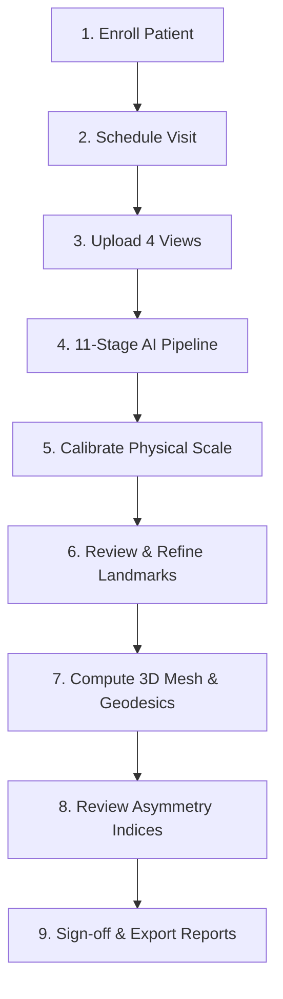

# AI Facial Asymmetry Analysis Platform — User Manual & Operating Instructions

> **Regulatory & Clinical Research Disclaimer**: This software platform is strictly engineered for clinical research measurement, bilateral asymmetry documentation, and longitudinal study data management. Quantitative measurements, AI landmark predictions, 3D surface reconstructions, and biostatistical outputs do **not** constitute medical diagnoses, clinical treatment plans, or autonomous surgical recommendations. All outputs require validation and sign-off by a qualified clinical examiner.

---

## Table of Contents
1. [Platform Overview & Study Scope](#1-platform-overview--study-scope)
2. [User Roles & Access Permissions (RBAC)](#2-user-roles--access-permissions-rbac)
3. [Longitudinal Protocol & Study Milestones](#3-longitudinal-protocol--study-milestones)
4. [Step-by-Step Clinical Research Workflow](#4-step-by-step-clinical-research-workflow)
   - [Step 4.1: Enrolling a Patient](#step-41-enrolling-a-patient)
   - [Step 4.2: Scheduling & Initializing Study Visits](#step-42-scheduling--initializing-study-visits)
   - [Step 4.3: Standardized Multi-Modal Image Acquisition & Upload](#step-43-standardized-multi-modal-image-acquisition--upload)
   - [Step 4.4: 11-Stage AI Pipeline Execution & Real-Time Monitoring](#step-44-11-stage-ai-pipeline-execution--real-time-monitoring)
   - [Step 4.5: Physical Scale Calibration (Ruler Fiducials & OPG Scaling)](#step-45-physical-scale-calibration-ruler-fiducials--opg-scaling)
   - [Step 4.6: Interactive Landmark Review & Audit Refinement (SVG/Canvas)](#step-46-interactive-landmark-review--audit-refinement-svgcanvas)
   - [Step 4.7: Interactive 3D Mesh Reconstruction & Dijkstra Geodesic Surface Paths](#step-47-interactive-3d-mesh-reconstruction--dijkstra-geodesic-surface-paths)
   - [Step 4.8: Quantitative Asymmetry Indices & Longitudinal Biostatistics](#step-48-quantitative-asymmetry-indices--longitudinal-biostatistics)
   - [Step 4.9: 13-Section Research Reports & Multi-Format Export](#step-49-13-section-research-reports--multi-format-export)
5. [System Administration & Database-Backed Settings](#5-system-administration--database-backed-settings)
   - [Dynamic API Key Configuration (Gemini, NVIDIA, OpenAI)](#dynamic-api-key-configuration-gemini-nvidia-openai)
   - [User Management & Role Assignment](#user-management--role-assignment)
   - [Immutable Audit Trail & Regulatory Compliance](#immutable-audit-trail--regulatory-compliance)
6. [Single-Shot Execution & Troubleshooting FAQ](#6-single-shot-execution--troubleshooting-faq)

---

## 1. Platform Overview & Study Scope

The **AI Facial Asymmetry Analysis Platform** is an enterprise-grade clinical research system designed to standardize, accelerate, and validate quantitative facial asymmetry assessments in patients who have sustained **unilateral mandibular fractures treated by open or closed reduction and internal fixation (ORIF)**.

### Core Objectives
1. **Longitudinal Precision**: Track facial and mandibular bilateral symmetry across **five fixed chronological visits** from pre-injury/pre-operation through 6 months post-fixation.
2. **Multi-Modal Verification**: Correlate soft-tissue surface photos (Frontal, Right Lateral, Left Lateral) with underlying bony structures using Orthopantomograms (OPG).
3. **Dual-Coordinate Audit Trail**: Preserve raw AI landmark predictions (`predicted_x`, `predicted_y`) alongside human examiner refinements (`examiner_x`, `examiner_y`) with immutable timestamped change logs.
4. **Physical Scale Rigor**: Strictly prevent arbitrary screen PPI assumptions (`1 mm ≠ 3.78 px`). Every measurement requires two-point fiducial ruler calibration or device magnification factor correction.
5. **Biostatistical Validity**: Compute bilateral difference metrics (`|R - L|`), relative Asymmetry Indices (`%`), Intraclass Correlation Coefficients (`ICC(2,1)`), and Bland–Altman agreement limits.

---

## 2. User Roles & Access Permissions (RBAC)

The platform enforces strict Role-Based Access Control (RBAC). All test accounts share the default development password: **`Research@2026`**.

| Role Name | Default Seed Account | Primary Responsibilities & Permitted Modules |
| :--- | :--- | :--- |
| **System Administrator** | `admin@faplatform.org` | Full system governance, user provisioning, database configuration, dynamic API keys, system audit logs, and storage maintenance. |
| **Principal Investigator (PI)** | `pi@faplatform.org` | Multi-center study oversight, clinical protocol parameters, visit sign-offs, regulatory audit logs, clinical and AI telemetry review. |
| **Research Coordinator** | `coordinator@faplatform.org` | Patient recruitment, demographic entry, visit scheduling, multi-modal image upload, and AI pipeline dispatch. |
| **Clinician / Examiner** | `examiner@faplatform.org` | Physical scale calibration, interactive SVG landmark refinement, approval of bilateral measurements, and formal visit sign-off. |
| **Research Analyst** | `analyst@faplatform.org` | Anonymized longitudinal data querying, statistical modeling (`ICC`, Bland–Altman), report generation, and data export. |
| **Read-only Researcher** | `readonly@faplatform.org` | Observation-only access to de-identified patient timelines, asymmetry graphs, and validated research reports. |

---

## 3. Longitudinal Protocol & Study Milestones

Each enrolled subject is tracked across 5 mandatory longitudinal time points:

```
[ Visit 1: PreOperative ]
         │ (Surgery & Internal Fixation)
         ▼
[ Visit 2: PostOp1Week ]  ─── Early post-surgical edema baseline & fixation alignment
         │
         ▼
[ Visit 3: PostOp6Weeks ] ─── Primary bony union & initial soft tissue swelling reduction
         │
         ▼
[ Visit 4: PostOp3Months ] ── Bone remodeling & intermediate dynamic facial symmetry
         │
         ▼
[ Visit 5: PostOp6Months ] ── Final stable anatomical and soft tissue symmetry evaluation
```

---

## 4. Step-by-Step Clinical Research Workflow



### Step 4.1: Enrolling a Patient
1. Navigate to **Patients** in the left navigation sidebar.
2. Click **"+ New Patient"**.
3. Complete the enrollment form:
   - **De-identified Study ID**: Format `FA-2026-XXXX` (maintains privacy).
   - **Demographics**: Biological sex, age at injury.
   - **Fracture Anatomy**: Unilateral fracture location:
     - *Condyle / Subcondyle*
     - *Angle*
     - *Body*
     - *Symphysis / Parasymphysis*
     - *Ramus*
   - **Fixation Protocol**: Treatment classification (e.g. *ORIF with 2.0mm miniplates*, *Lag screw fixation*, *Closed reduction with IMF*).
4. Click **Save Patient Record**.

### Step 4.2: Scheduling & Initializing Study Visits
1. From the Patient Details page, click **"Add Study Visit"**.
2. Select the protocol visit milestone (`PreOperative`, `PostOp1Week`, `PostOp6Weeks`, `PostOp3Months`, `PostOp6Months`).
3. Set the clinical examination date and assigning examiner.
4. The visit dashboard opens showing the **4 Required View Slots**.

### Step 4.3: Standardized Multi-Modal Image Acquisition & Upload
Upload the four standardized views required for bilateral asymmetry validation:

1. **Standardized Frontal Facial Photo**:
   - Patient in Natural Head Position (NHP), neutral facial expression, lips gently closed.
   - Must include a physical millimeter ruler or circular calibration sticker affixed to the mid-forehead or chin.
2. **Right Lateral Facial Photo**:
   - Exact 90° profile view demonstrating the right mandibular ramus, gonial angle, and pogonion.
3. **Left Lateral Facial Photo**:
   - Exact 90° contralateral profile view.
4. **Orthopantomogram (OPG)**:
   - Digital panoramic radiograph depicting condylar heights, ramal symmetry, and fracture reduction plates.

*Supported formats*: `.jpg`, `.jpeg`, `.png`, `.webp`, `.dcm` (DICOM). Max size: 25 MB per image.

### Step 4.4: 11-Stage AI Pipeline Execution & Real-Time Monitoring
1. Once images are uploaded, click **"Run AI Analysis Pipeline"**.
2. The platform initiates the automated 11-stage processing engine with live Server-Sent Events (SSE) streaming:
   - **Stage 1: Validation** — Checks image integrity, resolution, lighting, and aspect ratio.
   - **Stage 2: Preprocessing** — Normalizes illumination, contrast, and color balance.
   - **Stage 3: FacialLandmarks** — Executes 478-point 3D neural landmark extraction (Google MediaPipe / NIM).
   - **Stage 4: Segmentation** — Generates anatomical masks (face oval, lips, eyes, nasal dorsum).
   - **Stage 5: QualityCheck** — Evaluates head rotation, roll, and tilt tolerances.
   - **Stage 6: SurfaceReconstruction** — Synthesizes 3D triangular face mesh with depth estimation.
   - **Stage 7: GeodesicCompute** — Calculates shortest surface paths along mesh curvature (Dijkstra algorithm).
   - **Stage 8: BiomechanicalAnalysis** — Evaluates soft-tissue tension vectors across the mandibular border.
   - **Stage 9: Calibration** — Detects physical markers and prompts examiner scale validation.
   - **Stage 10: AsymmetryCompute** — Calculates bilateral Euclidean, geodesic, and horizontal offsets.
   - **Stage 11: ReportDrafting** — Synthesizes an executive narrative report via Google Gemini or local LLM.

### Step 4.5: Physical Scale Calibration (Ruler Fiducials & OPG Scaling)
> [!IMPORTANT]
> Uncalibrated measurements are marked with an orange alert badge: `Unscaled (px)`. They cannot be included in final statistical publications until calibrated.

1. Open the **Scale Calibration** tab for each uploaded image.
2. **For Photographic Views (Frontal, Laterals)**:
   - Select **"Two-Point Ruler Calibration"**.
   - Click Point A and Point B on the visible physical ruler or marker in the image.
   - Enter the known physical length in millimeters (e.g. `20.0 mm`).
   - The engine computes `Scale Factor = known_mm / measured_px`.
3. **For OPG Radiographs**:
   - Select **"OPG Magnification Factor"**.
   - Input the machine-specific panoramic magnification index (typically `1.20x` to `1.30x`).
   - Enter reference mandibular condyle-to-gonion known scale.
4. Click **Apply Physical Scale**. All measurements instantly convert from pixels to verified millimeters (`mm`).

### Step 4.6: Interactive Landmark Review & Audit Refinement (SVG/Canvas)
1. Navigate to the **Landmarks** tab.
2. Select any landmark group (*Mandibular Border*, *Cheilion / Oral Commissures*, *Nasion / Exocanthion*, *Gonion / Menton*).
3. Use the mouse wheel to zoom (up to 400%) and drag to pan across high-resolution imagery.
4. Click and drag any predicted landmark to its precise anatomical boundary.
5. When refined:
   - The original AI coordinates (`predicted_x`, `predicted_y`) remain permanently archived in the database.
   - The refined coordinates (`examiner_x`, `examiner_y`) are registered with examiner ID and timestamp.
   - Enter an optional refinement clinical rationale (e.g., *"Adjusted left gonion 1.8mm laterally due to post-surgical soft tissue edema"*).
6. Click **"Save & Approve Landmarks"**.

### Step 4.7: Interactive 3D Mesh Reconstruction & Dijkstra Geodesic Surface Paths
1. Navigate to the **3D Reconstruction** tab.
2. An interactive WebGL/Three.js 3D viewport renders the patient's reconstructed facial surface.
3. Features:
   - **Rotate & Inspect**: Left-click drag to tumble 3D geometry; right-click drag to translate; scroll to zoom.
   - **Geodesic Path Visualization**: Renders true Dijkstra surface paths across the facial curvature rather than simple straight-line 2D projections.
   - **Quality Grading**: Displays mesh completeness (`Complete`, `Partial`, `LowConfidence`).
   - **Export 3D Asset**: Click **"Download .OBJ"** or **"Download .PLY"** to export for external CAD/stereolithography software.

### Step 4.8: Quantitative Asymmetry Indices & Longitudinal Biostatistics
1. Open the **Asymmetry Analysis** tab.
2. View key bilateral paired anatomical landmarks:
   - **Gonion (Go-R vs Go-L)**: Ramal and jaw angle symmetry.
   - **Cheilion (Ch-R vs Ch-L)**: Oral commissure horizontal canting and lateral distance.
   - **Exocanthion (Ex-R vs Ex-L)**: Lateral eye corner balance.
   - **Subnasale to Menton (Sn-Me)**: Lower facial third vertical midline deviation.
3. Review mathematical outputs:
   - **Absolute Difference**: $\Delta = |R - L| \text{ (mm)}$
   - **Asymmetry Index (AI %)**: $\text{AI} = \frac{|R - L|}{R + L} \times 100\%$
   - **Midline Deviation**: Horizontal perpendicular offset from true facial midsagittal plane.
4. **Longitudinal Trajectory Chart**:
   - Directly graphs the patient's recovery trajectory across all completed visits.
   - Demonstrates quantitative reduction of asymmetry index toward normal anatomical limits ($\le 3\%$).

### Step 4.9: 13-Section Research Reports & Multi-Format Export
1. Click **"Generate Research Report"**.
2. Select desired export format:
   - **PDF Comprehensive Dossier**: Fully formatted publication report with high-resolution image overlays, landmark tables, asymmetry bar graphs, and clinical disclaimers.
   - **CSV / Excel (.xlsx)**: Raw tabular measurements, ideal for import into SPSS, R, SAS, or STATA.
   - **JSON Clinical Record**: Interoperable HL7/FHIR-compatible research data payload.
   - **3D Mesh Files (.OBJ, .PLY)**: Standard polygon geometry.
3. All report generations are logged to the immutable audit trail.

---

## 5. System Administration & Database-Backed Settings

Administrators can configure the platform via **Administration** -> **System Settings** (`/settings` or `/admin/settings`).

### Dynamic API Key Configuration (Gemini, NVIDIA, OpenAI)
API keys are stored directly in the `system_settings` relational database table with automatic secret masking (`••••••••`) and memory caching.

| Configuration Key | Description & Target Service |
| :--- | :--- |
| **`GEMINI_API_KEY`** | Google Gemini 2.5/2.0 API key for automated narrative report drafting and multimodal image inspection. |
| **`NVIDIA_API_KEY`** | NVIDIA NIM API key for hardware-accelerated cloud neural landmark models and segmentation. |
| **`OPENAI_API_KEY`** | OpenAI API key for GPT-4o vision analysis and secondary clinical report summarization. |
| **`CUSTOM_GPU_API_KEY`** | Bearer token for proprietary on-premise Triton/PyTorch inference server clusters. |
| **`STORAGE_BACKEND`** | File storage provider (`database` for zero-setup relational blob storage, `local` for disk, or `s3` for AWS S3). |
| **`TASK_BACKEND`** | Pipeline execution engine (`inline` for synchronous/background asyncio, or `celery` with Redis broker). |
| **`ALLOW_EXTERNAL_AI_UPLOADS`** | Set to `true` to allow cloud AI providers (Gemini/NVIDIA), or `false` for strictly air-gapped on-premise execution. |

> [!TIP]
> Changes saved in the System Settings UI take effect immediately across all worker nodes **without restarting the backend server**.

### User Management & Role Assignment
1. Go to **Administration** -> **User Management**.
2. View active researchers, login frequencies, and assigned privileges.
3. Click **"+ Add User"** to provision a new investigator or examiner with email, full name, role, and temporary password.
4. Account deactivation or role adjustments update session tokens immediately.

### Immutable Audit Trail & Regulatory Compliance
1. Go to **Administration** -> **Audit Logs**.
2. Displays an append-only, chronologically sorted ledger of every critical system transaction:
   - User authentications and logouts.
   - Patient enrollment and record edits.
   - Image uploads and deletions.
   - Landmark drag adjustments (storing previous vs new coordinates).
   - Physical scale factor calibrations.
   - System setting and API key modifications.
3. Audit log records are cryptographically protected by database triggers and cannot be deleted or modified by any user role.

---

## 6. Single-Shot Execution & Troubleshooting FAQ

### How to Start or Update the Platform in One Click
Double-click **`run.bat`** in the project root directory.

- **Auto-Sync**: Checks for and pulls the latest code from GitHub automatically.
- **Resource Reuse**: Automatically reuses existing `fa_postgres` (PostgreSQL 16) and `fa_redis` containers and caches without data loss.
- **Auto-Rebuild**: Rebuilds only the backend and frontend containers with your latest source updates.
- **Browser Launch**: Verifies health and opens your default browser at `http://localhost:5173`.

### Frequently Asked Questions

**Q1: "Why do my measurements say 'Unscaled'?"**  
*Answer*: Measurements require physical calibration before they can be reported in millimeters. Open the visit, go to the Calibration tab, select two points on your visible ruler fiducial, and enter its known physical length in millimeters.

**Q2: "Can I use the platform completely offline without internet?"**  
*Answer*: Yes! The platform includes pre-downloaded Google MediaPipe 478-point neural models (`backend/models/mediapipe/`). Set `ALLOW_EXTERNAL_AI_UPLOADS=false` in System Settings to ensure no data ever leaves the local network.

**Q3: "Where are the interactive Swagger API docs?"**  
*Answer*: When running, visit `http://localhost:5173/docs` or `http://localhost:8000/docs` to inspect and execute all 40+ REST API endpoints interactively.

**Q4: "How do I stop or restart all containers?"**  
*Answer*: In the `run.bat` console window, press `S` to stop containers, `R` to restart them, or `L` to stream live log output. Alternatively, run `docker-compose down` in any terminal.

---

*AI Facial Asymmetry Analysis Platform — Research Documentation & Operating Manual (2026).*
