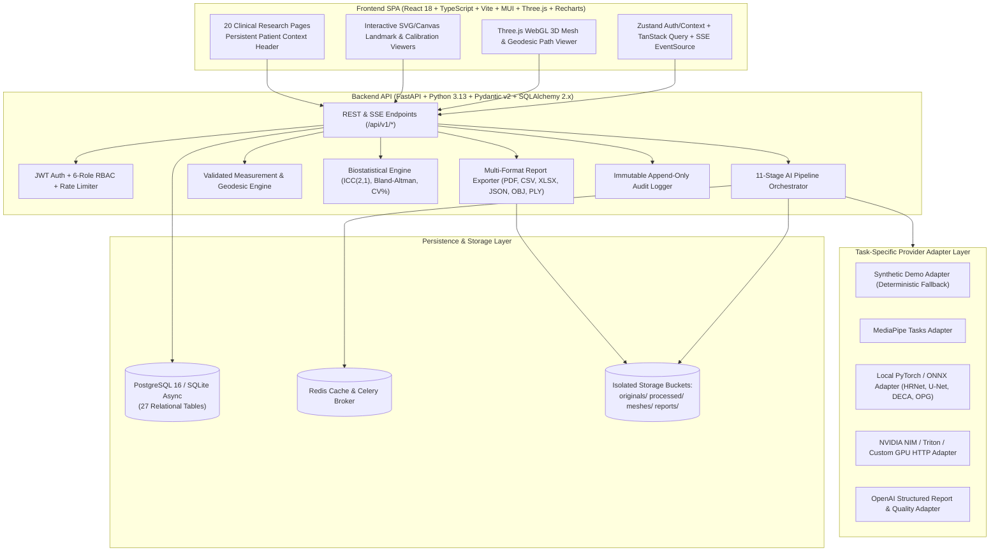

# System Architecture — AI Facial Asymmetry Analysis Platform

## 1. Architectural Overview

The **AI Facial Asymmetry Analysis Platform** is a modular, full-stack clinical research web application engineered to quantify longitudinal facial and mandibular asymmetry in patients with unilateral mandibular fractures treated by open reduction and internal fixation (ORIF) or closed fixation.

The platform is strictly designed for **research measurement and documentation only** and enforces non-diagnostic disclaimers across all screens, API payloads, and exported PDF/Excel/CSV/JSON reports.

## 2. 11-Stage AI & Quantitative Analysis Pipeline

Every visit analysis executes an explicit 11-stage pipeline (`backend/app/ai/orchestrator.py`) with real-time Server-Sent Events (SSE) progress updates:

1. **Stage 1 (`ImageQuality`)**: Validates resolution, blur (Laplacian variance), lighting, framing, orientation, and occlusion across Frontal, Right Lateral, Left Lateral, and OPG images.
2. **Stage 2 (`FaceDetection`)**: Detects face bounding boxes and verifies anatomical orientation.
3. **Stage 3 (`FacialLandmarks`)**: Predicts 16 standardized facial anthropometry landmarks (`Tr`, `G`, `N`, `Prn`, `Sn`, `Ls`, `Li`, `Pg`, `Gn`, `Me`, `Ex_R/L`, `En_R/L`, `Zy_R/L`, `Al_R/L`, `Ch_R/L`, `Go_R/L`).
4. **Stage 4 (`FacialSegmentation`)**: Generates midline reference vector, bilateral contour masks, and bigonial/commissural reference lines.
5. **Stage 5 (`Reconstruction3D`)**: Synthesizes a 3D facial mesh (`.obj` and `.ply`), projects 3D landmarks, computes Dijkstra surface geodesic paths, and evaluates coverage (`Complete`, `Partial`, `LowConfidence`, `Failed`, `RequiresReview`).
6. **Stage 6 (`OPGLandmarks`)**: Detects 7 mandibular radiographic landmarks (`Co_R/L`, `Cor_R/L`, `Go_OPG_R/L`, `Xi_R/L`, `MF_R/L`, `Ag_R/L`, `Me_OPG`, `DentMid`).
7. **Stage 7 (`OPGSegmentation`)**: Segments mandibular cortical outline, condylar heads, rami, and fracture/fixation zones.
8. **Stage 8 (`ScaleValidation`)**: Verifies view-specific physical calibrations (`FrontalPhoto`, `RightLateralPhoto`, `LeftLateralPhoto`, `OPG`) and rejects generic screen PPI assumptions.
9. **Stage 9 (`GeometryCalculation`)**: Executes `MeasurementEngine` to compute 14 bilateral linear, angular, OPG, and 3D geodesic measurements and Asymmetry Index (%).
10. **Stage 10 (`FollowUpComparison`)**: Updates longitudinal trajectory series across Pre-op, 1W, 6W, 3M, and 6M visits without interpolating missing visits.
11. **Stage 11 (`ReportGeneration`)**: Compiles structured 13-section research summaries.

## 3. Clinical Governance & Security Invariants

- **Non-Completion Rule**: Completing AI pipeline execution transitions a visit to `ReviewRequired` — never `Completed`. A visit can only become `Completed` after an authorized examiner approves the visit's measurements.
- **Dual-Coordinate Preservation**: `LandmarkPrediction` stores `predicted_x` / `predicted_y` (AI) and `examiner_x` / `examiner_y` (Examiner) in separate columns, while `LandmarkReview` records the full history of adjustments and reasons.
- **External Upload Guard**: `ALLOW_EXTERNAL_AI_UPLOADS=false` by default blocks sending identifiable clinical images to external cloud APIs unless explicitly enabled.
