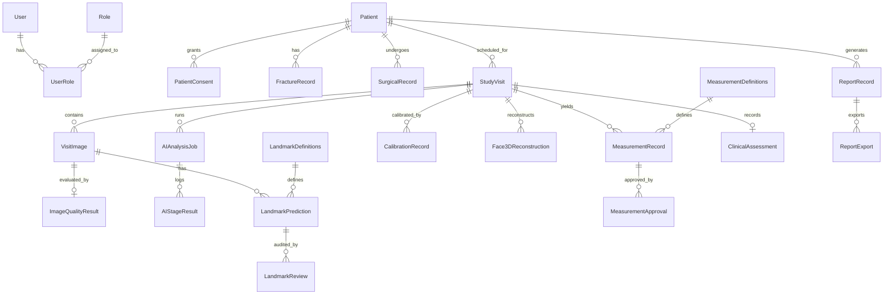

# Database Design — 27 Relational Tables

The database schema is implemented in SQLAlchemy 2.x (`backend/app/models/`) and Alembic (`backend/migrations/versions/0001_initial_schema.py`). It supports PostgreSQL 16 in production and async SQLite for zero-dependency local Windows execution.

## 1. Entity-Relationship Diagram

## 2. Complete Table Catalogue (27 Tables)

| # | Table Name | Model Class | Primary Purpose & Key Columns |
|---|---|---|---|
| 1 | `users` | `User` | Researcher accounts (`email`, `hashed_password`, `is_active`, `last_login_at`) |
| 2 | `roles` | `Role` | 6 RBAC roles (`name`, `permissions_json`) |
| 3 | `user_roles` | `UserRole` | Many-to-many join between `users` and `roles` |
| 4 | `user_sessions` | `UserSession` | Active JWT refresh sessions (`token_jti`, `ip_address`, `revoked_at`) |
| 5 | `password_reset_tokens` | `PasswordResetToken` | Single-use password reset tokens (`token_hash`, `expires_at`, `used_at`) |
| 6 | `patients` | `Patient` | Coded study participants (`patient_code`, `age_at_enrollment`, `sex`, `study_status`, `is_synthetic`) |
| 7 | `patient_consents` | `PatientConsent` | IRB/ethics consent records (`consent_status`, `consent_date`, `document_reference`) |
| 8 | `fracture_records` | `FractureRecord` | Unilateral mandibular fracture details (`fracture_side`, `fracture_type`, `fracture_location`, `injury_mechanism`) |
| 9 | `surgical_records` | `SurgicalRecord` | Fixation details (`surgery_date`, `fixation_type`, `surgical_approach`, `plate_details`, `surgeon_name`) |
| 10 | `study_visits` | `StudyVisit` | 5 longitudinal visits per patient (`visit_type`, `planned_date`, `actual_date`, `status`) |
| 11 | `visit_images` | `VisitImage` | Uploaded/synthetic images (`image_type`, `storage_path`, `width`, `height`, `acceptance_status`) |
| 12 | `image_quality_results` | `ImageQualityResult` | Quality screening (`overall_score`, `status`, `blur_check`, `lighting_check`, `manual_override_status`) |
| 13 | `ai_provider_configs` | `AIProviderConfig` | Task-specific AI adapter settings (`task_type`, `provider_name`, `model_name`, `model_version`, `api_key_env_var`) |
| 14 | `ai_analysis_jobs` | `AIAnalysisJob` | Per-stage execution jobs (`visit_id`, `stage_order`, `task_type`, `provider`, `status`, `duration_seconds`) |
| 15 | `ai_stage_results` | `AIStageResult` | Detailed JSON output and warnings per stage (`job_id`, `output_json`, `warnings_json`) |
| 16 | `landmark_definitions` | `LandmarkDefinition` | Protocol landmark catalogue (`code`, `name`, `side`, `anatomical_region`, `landmark_type`) |
| 17 | `landmark_predictions` | `LandmarkPrediction` | Dual-coordinate storage (`predicted_x`, `predicted_y`, `examiner_x`, `examiner_y`, `confidence`, `status`) |
| 18 | `landmark_reviews` | `LandmarkReview` | Append-only landmark correction history (`reviewer_id`, `original_x`, `corrected_x`, `correction_reason`) |
| 19 | `calibration_records` | `CalibrationRecord` | View-specific physical calibration (`calibration_type`, `known_marker_length_mm`, `measured_marker_length_px`, `mm_per_pixel`, `is_physical`) |
| 20 | `face_3d_reconstructions` | `Face3DReconstruction` | 3D mesh metadata & geodesic paths (`coverage_status`, `obj_storage_path`, `ply_storage_path`, `surface_paths_json`) |
| 21 | `measurement_definitions` | `MeasurementDefinition` | Protocol measurement formulas (`code`, `name`, `measurement_type`, `unit`, `source_view`, `formula`) |
| 22 | `measurement_records` | `MeasurementRecord` | Quantitative outputs (`right_value`, `left_value`, `absolute_difference`, `asymmetry_index`, `method`, `status`, `is_unscaled`) |
| 23 | `measurement_approvals` | `MeasurementApproval` | Examiner sign-off records (`approver_id`, `approval_status`, `comments`, `approved_at`) |
| 24 | `clinical_assessments` | `ClinicalAssessment` | Clinical healing parameters (`swelling_grade`, `occlusion_status`, `neurosensory_status`, `interincisal_opening_mm`) |
| 25 | `report_records` | `ReportRecord` | 13-section research reports (`report_code`, `title`, `content_json`, `pdf_storage_path`, `xlsx_storage_path`) |
| 26 | `report_exports` | `ReportExport` | Audit log of report file downloads (`format`, `storage_path`, `exported_by_id`) |
| 27 | `audit_logs` & `notifications` | `AuditLog`, `Notification` | Immutable regulatory audit trail (`before_json`, `after_json`, `action_type`) and in-app notifications |
| 28 | `stored_blobs` | `StoredBlob` | Database-backed binary object storage (`storage_key`, `category`, `mime_type`, `byte_size`, `sha256_hash`, `content` `BYTEA`/`BLOB`) storing all uploaded images, 3D meshes, and exported reports transactionally inside the database |

